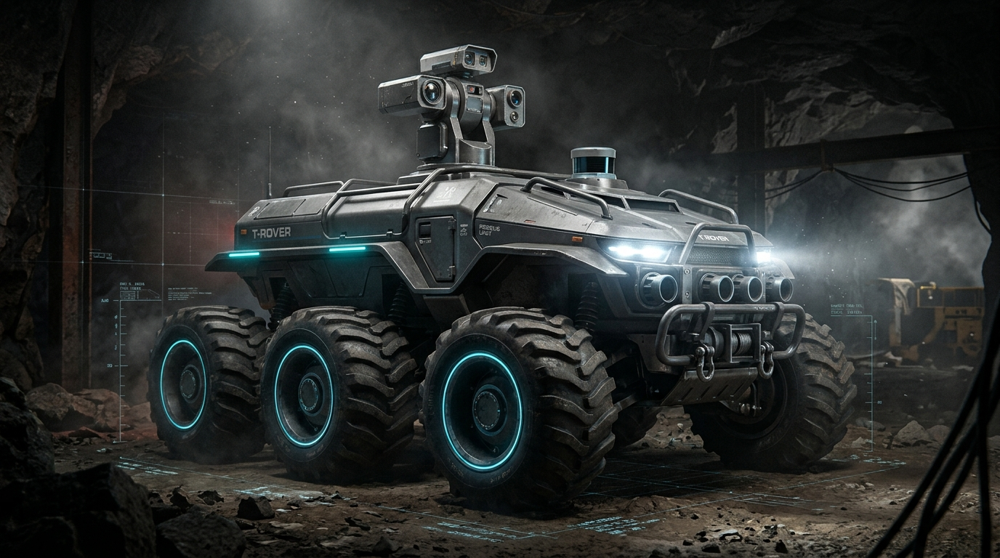

# TRAYATE — Intelligent Mine Safety & Rescue System

> **Official SaaS Landing Page for TRAYATE & T-Rover Autonomous Industrial Mine Rescue Platform**



---

## 🛰️ Overview

**TRAYATE** is an AI-powered mine safety and rescue rover platform. The public-facing landing page is designed with a dark, sophisticated B2B industrial robotics SaaS aesthetic inspired by **Linear**, **Vercel**, and **Stripe**. It is tailored for mining enterprises, safety directors, and emergency rescue operations.

---

## 🎨 Design Direction & Brand Identity

- **Aesthetic:** Minimal, dark SaaS industrial robotics aesthetic with restrained cyan ambient glows, hairline borders, and generous negative space.
- **Color System:**
  - `Background`: `#080D14` (Deep obsidian dark-field)
  - `Secondary Background`: `#0D1520`
  - `Card Background`: `#111B27`
  - `Borders`: `#243244` / `#182332`
  - `Primary Accent`: `#38BDF8` (Sky cyan)
  - `Secondary Accent`: `#0EA5E9` (Vivid cyan)
  - `Primary Text`: `#F8FAFC`
  - `Secondary Text`: `#94A3B8`
  - `Status Success`: `#22C55E`
  - `Status Warning`: `#F59E0B`
  - `Status Danger`: `#EF4444`
- **Typography:**
  - **Headings:** `Space Grotesk`
  - **Body / Prose:** `Inter`
  - **Telemetry & Labels:** `JetBrains Mono`
- **Iconography:** Lucide Icons (CDN)

---

## 📑 Page Structure & Sections

1. **Sticky Navigation Bar:**
   - Abstract geometric rover insignia + **TRAYATE** brand wordmark.
   - Smooth anchor navigation: *Home*, *Technology*, *T-Rover*, *Capabilities*, *About*.
   - Outlined action button: `Launch Command Centre ↗` with interactive preview modal.
   - Fully responsive collapsible mobile menu drawer.

2. **Full-Screen Hero Section:**
   - Technical eyebrow badge: `"NEXT-GENERATION MINE SAFETY TECHNOLOGY"`.
   - Headline: *"Into the depths. Beyond human limits."* with cyan gradient treatment.
   - Value proposition description for hazardous sub-surface monitoring.
   - Dual CTAs: `Explore T-Rover →` and `Launch Command Centre ↗`.
   - Technical micro-bar: `REAL-TIME MONITORING / INTELLIGENT DETECTION / REMOTE OPERATIONS`.
   - Right focal point: High-fidelity 3D industrial render of the **six-wheeled T-Rover** prototype encased in an engineered HUD reticle frame with live telemetry badges.

3. **Live System Status Strip:**
   - Real-time indicator ribbon demonstrating nominal hardware state:
     - `Rover Connectivity`: **ONLINE** (pulsing green dot)
     - `Sensor Network`: **ACTIVE** (cyan dot)
     - `Environmental Monitoring`: **LIVE** (green dot)
     - `DustCleaner`: **STANDBY** (amber dot)
   - Synchronized latency metric (`12ms`) and Supabase PostgreSQL data sync indicator.

4. **Technology & Capabilities (4 Bento Cards):**
   - `CARD 1 — Environmental Intelligence`: Continuous monitoring of CH4, CO, H2S, O2, and humidity.
   - `CARD 2 — AI-Powered Vision`: Dual optical & thermal feeds with edge neural inference for trapped miners, smoke, and ignition detection.
   - `CARD 3 — Smart Dust Mitigation`: Integrated DustCleaner cyclonic chamber for coal dust suppression.
   - `CARD 4 — Remote Operations`: Sub-15ms bidirectional control and emergency E-Stop overrides.

5. **Meet T-Rover Section (Product Showcase):**
   - High-impact engineering showcase featuring the 6WD rover with interactive component callouts:
     - *[01] 360° LIDAR & Optical Turret*
     - *[02] Multi-Gas Sniffer Array (CH4, CO, H2S, O2)*
     - *[03] Heavy-Duty 6x6 Independent Suspension*
     - *[04] Integrated DustCleaner Cyclonic Core*
   - Technical specifications grid detailing brushless hub mobility, 350mm clearance, and dual-core ESP32 RTOS control.

6. **How It Works (End-to-End Telemetry Pipeline):**
   - 5-stage horizontal architecture visualization:
     - `01 — SENSOR NETWORK` (I2C/SPI real-time readings)
     - `02 — ESP32 CONTROLLERS` (Hardware processing & PID loops)
     - `03 — MQTT COMMUNICATION` (Subterranean RF mesh stream)
     - `04 — CLOUD BACKEND` (Supabase real-time storage & alerting)
     - `05 — COMMAND CENTRE` (Surface operator HUD)

7. **Intelligent Monitoring Section (Dashboard Preview):**
   - Tactical dark glassmorphism preview with simulated live telemetry tickers:
     - 4 Gas cards: Methane (CH4), Carbon Monoxide (CO), Oxygen (O2), Hydrogen Sulfide (H2S).
     - Environmental metrics: Ambient Temperature (24.2°C), Relative Humidity (62.4%), Barometer (1,048 hPa), Air Quality (AQI 42).
     - Robotic camera feed with CRT scanline filter and simulated AI Bounding Box (`TARGET #01: HUMAN DETECTED [98.4% CONF]`).

8. **Final CTA:**
   - *"Building safer underground operations."* with radial cyan glow backdrop and standards badges (ISO 10218 & ATEX Zone 1 compliance).

9. **Footer:**
   - Brand identity, complete navigation links, resources, contact, GitHub link, and copyright notice.

---

## 🚀 How to Run Locally

You can open `index.html` directly in any web browser, or launch a lightweight local server:

### Option A: Using Node.js
```bash
npm start
# or
npx serve -l 3000 .
```
Then open `http://localhost:3000` in your browser.

### Option B: Using Python
```bash
python -m http.server 3000
```
Then open `http://localhost:3000` in your browser.

---

## 🔗 Stitch Project Reference
- **Project Title:** `TRAYATE - Intelligent Mine Safety & Rescue Landing Page`
- **Project ID:** `7125799599381368151`
- **Design System:** `Autonomous Kinetic Systems` (Dark mode, Space Grotesk / Inter / JetBrains Mono)

